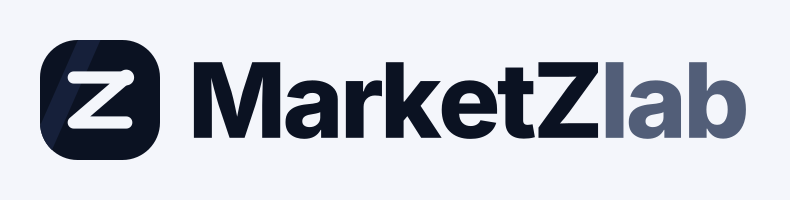

# Visita a tiendas: guion y preguntas frecuentes

**Objetivo de cada visita:** que la tienda **cree su cuenta ahí mismo y publique al menos 5 cartas** antes de que se vayan. Un "sí, después lo veo" casi nunca termina en cartas publicadas.

**Qué llevar:**
- Un teléfono con la página abierta y una sesión iniciada (para mostrarla).
- La tarjeta con el QR impresa: `docs/material/tarjeta-tiendas.html` (abrir en el navegador → Imprimir; salen 2 tarjetas por hoja).
- Dos copias impresas del acuerdo para tiendas: `docs/material/tiendas-acuerdo.pdf` (solicitud con dirección, teléfono, Instagram y Yappy, Términos para tiendas con el flujo de la venta y firmas). Una copia queda en la tienda y otra con nosotros.
- O, mejor, que la tienda lo firme ahí mismo en la página: Mi cuenta ▸ ¿Tienes una tienda? ▸ Llenar y firmar la solicitud (firma con el dedo). La solicitud nos llega a Panel ▸ Tiendas, la aprobamos desde ahí y las dos partes pueden descargar la copia firmada.
- Saber de memoria la comisión: **5% + ITBMS los primeros 6 meses desde que firma el acuerdo, después 8% + ITBMS. Solo cuando vende. Publicar es gratis.**

---

## Guion (2 minutos)

**1. Presentación (15 s)**
> "Hola, somos [nombre], de MarketZlab. Estamos armando la página para comprar y vender cartas en Panamá, con pago protegido. Antes de abrirla al público queremos que las tiendas ya tengan sus cartas adentro. ¿Le puedo mostrar en un minuto?"

**2. El problema que resolvemos (20 s)**
> "Hoy la gente compra por WhatsApp e Instagram y siempre está el miedo: ¿me paga?, ¿me manda la carta?, ¿es real? En MarketZlab el comprador le paga a MarketZlab, nosotros guardamos el dinero, pasamos a buscar la carta a su tienda y le pagamos ahí mismo. Así se vende más, porque el comprador confía."

**3. Demostración (60 s)** — en el teléfono:
1. **Portada:** las cartas con su precio y el sello de tienda verificada.
2. **Una carta:** la gráfica de precio de mercado y el panel de Compra Protegida.
3. **Vender ▸ "Súbelas todas juntas"** (si tiene graduadas): una foto por slab y la página lee la empresa, la nota y el certificado.
4. **Mi cuenta:** el panel con vistas, interesados y ofertas de cada carta.

**4. Lo que cuesta (15 s)**
> "Publicar es gratis. Solo cuando vende, MarketZlab se queda con el 5% más ITBMS durante sus primeros 6 meses: en una carta de $100 usted recibe $94.65. Después la comisión pasa a 8% más ITBMS: recibe $91.44. El comprador paga solo el precio."

**5. Cierre (10 s)**
> "¿Le ayudamos a crear la cuenta y subir sus primeras 5 cartas ahora? Toma 5 minutos."

Si dice que no tiene tiempo: dejar la tarjeta con el QR y **anotar una fecha** para volver.

---

## Preguntas frecuentes

| Pregunta | Respuesta |
|---|---|
| **¿Cuánto me cobran?** | Nada por publicar. Solo si vende: 5% del precio de venta + 7% de ITBMS sobre esa comisión durante los primeros 6 meses desde que firma el acuerdo; después, 8% + ITBMS. |
| **¿Cuándo me pagan?** | En el momento en que pasamos a buscar la carta a su tienda: le pagamos por Yappy el precio menos la comisión. No espera a que la carta le llegue al comprador. |
| **¿Quién entrega la carta?** | MarketZlab. Pasamos a buscarla a su tienda (en las 48 horas siguientes a la venta), la guardamos y la repartimos al comprador el día de distribución, un día fijo a la semana. Desde que la retiramos, la carta es responsabilidad nuestra. |
| **¿Y si el comprador dice que no le llegó o que es falsa?** | Tiene 3 días para reclamar con fotos. Revisamos cada caso. Si el reclamo no procede, le pagamos igual. |
| **¿Qué pasa con las cartas falsas?** | Están prohibidas. Si detectamos una, retiramos el anuncio y cerramos la cuenta. A las tiendas serias eso les conviene: limpia la competencia desleal. |
| **¿Puedo seguir vendiendo en mi tienda?** | Sí. Si vende la carta por fuera, márquela como vendida en MarketZlab para que deje de aparecer. Lo que no se puede es cerrar por fuera una venta que salió de MarketZlab. |
| **¿Cuándo abre al público?** | Cuando activemos el pago con Yappy. Por eso estamos invitando primero a las tiendas: para abrir con cartas ya publicadas. |
| **¿Qué es el sello de tienda verificada?** | Revisamos que la tienda existe (foto del local, ubicación). Sus anuncios salen con el sello y tienen su propio filtro en la portada. |
| **¿Puedo subir cajas, sobres o ETB?** | Sí, en Vender ▸ "Publica producto sellado". Tiene que estar sellado de fábrica. |
| **¿Puedo subir muchas cartas sin graduar de una vez?** | Por ahora, la carga múltiple es solo para graduadas. Las sueltas se suben de a una con la foto (la página reconoce la carta y sugiere el precio). |
| **¿Qué datos míos ven los compradores?** | El nombre de la tienda, la foto, la descripción y el barrio. Nunca su teléfono ni su correo. |

**Lo que NO hay que prometer:** que la página es "la #1", fechas de lanzamiento exactas, ventas aseguradas, ni que MarketZlab revisa todas las cartas (no lo hace; la Revisión en tienda es un servicio aparte).

---

## Después de la visita

Anotar en una lista compartida, por cada tienda:
- Nombre, contacto, quién la visitó y la fecha.
- Resultado: cuenta creada / cartas publicadas / volver el [fecha].
- Qué objeciones puso (sirven para mejorar la página y este guion).

Revisar en el panel de staff ▸ **Tiendas** las solicitudes de verificación nuevas y aprobarlas el mismo día.
